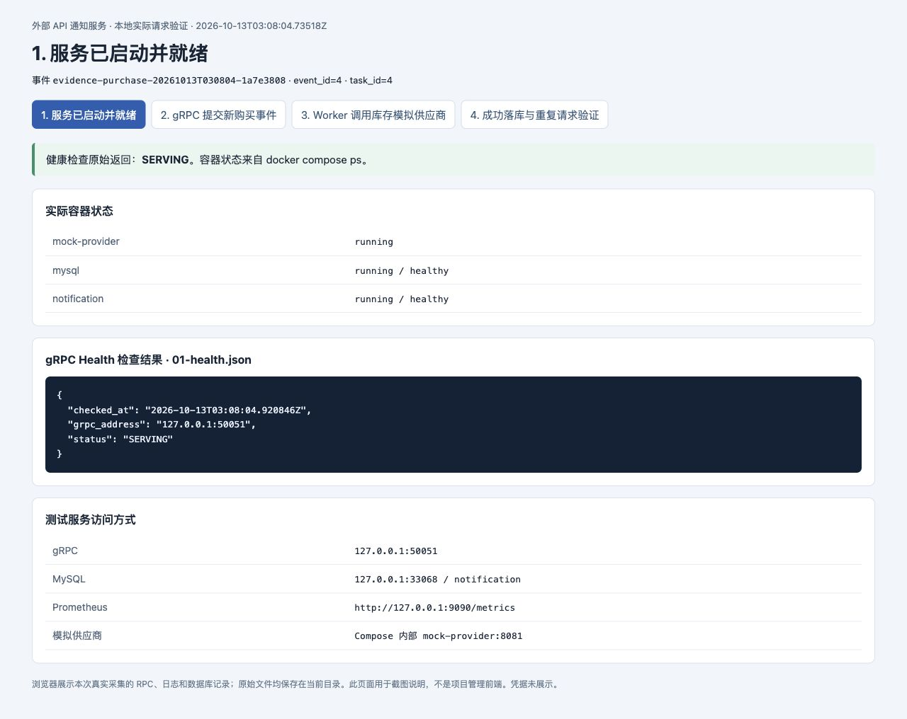
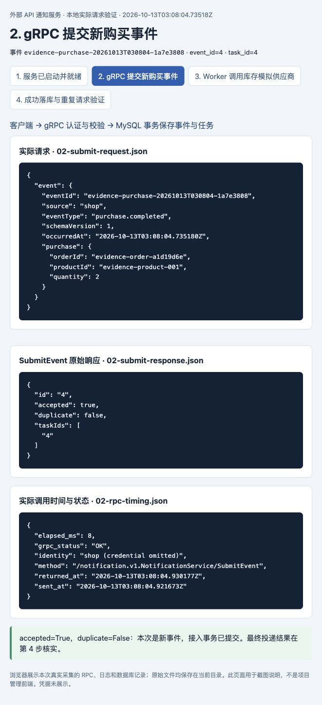
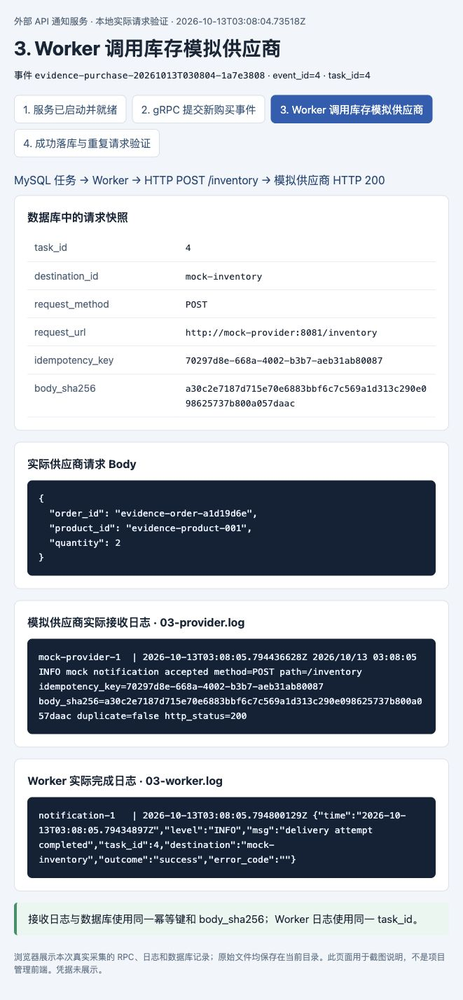
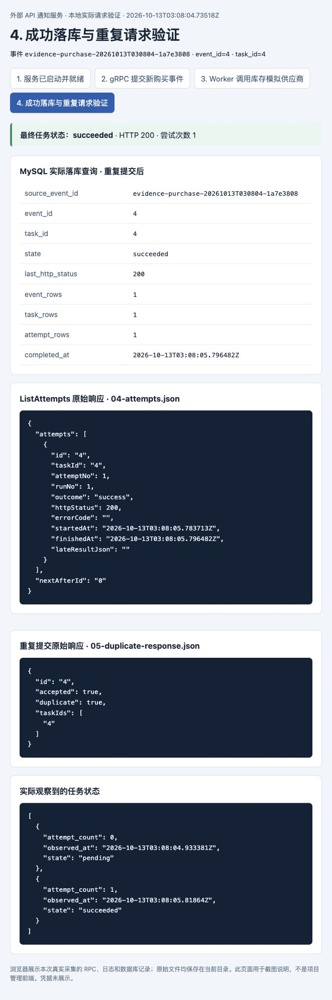

# 通知服务完整请求验证

2026 年 10 月 13 日，本地实际运行通知服务、MySQL 8.4 和库存模拟供应商，完成了一次新购买事件的完整投递。gRPC 接入返回成功，Worker 向下游发送 HTTP 请求，下游确认接收，任务最终为 `succeeded`，数据库保存 1 个事件、1 个任务和 1 次成功投递记录。再次提交相同事件返回原事件与任务。

本次验证的是本地模拟库存 API 的完整链路。截图来自浏览器中的证据展示页，页面展示实际采集的 RPC 响应、容器日志和数据库结果；不是业务管理前端。原始记录随截图保存在仓库中，未展示认证凭据。

## 本次请求信息

| 项目 | 实际值 |
| --- | --- |
| 执行时间 | 2026-10-13 11:08:04 至 11:08:06，Asia/Shanghai |
| 来源事件 ID | `evidence-purchase-20261013T030804-1a7e3808` |
| 来源与事件类型 | `shop` / `purchase.completed` |
| 数据库事件 ID | `4` |
| 投递任务 ID | `4` |
| 目标 | `mock-inventory` |
| 订单 | `evidence-order-a1d19d6e` |
| 商品与数量 | `evidence-product-001`，数量 2 |
| 下游地址 | `POST http://mock-provider:8081/inventory` |
| 最终结果 | `succeeded`，HTTP 200，尝试次数 1 |

原始记录中的 `Z` 时间为 UTC，比北京时间早 8 小时。事件、任务和幂等键用于将各阶段的记录关联到同一次请求。

## 1 启动服务并检查就绪

本次使用仓库提供的本机编译镜像方式，启动 Compose 中的三个服务：

```sh
scripts/build-local-image.sh
docker compose --env-file .env.example -f deploy/compose.yaml \
  up -d --no-build --wait --wait-timeout 90
```

`notification` 和 `mysql` 均为 `running / healthy`，`mock-provider` 为 `running`。实际 gRPC Health 检查返回 `SERVING`，表示通知服务、数据库与 Worker 已就绪。



原始依据：[容器状态](evidence/full-request-20261013-01/01-compose-status.txt)、[健康检查](evidence/full-request-20261013-01/01-health.json)。

## 2 通过 gRPC 提交全新事件

客户端使用 `shop` 来源凭据调用 `notification.v1.NotificationService/SubmitEvent`，提交购买事件。服务返回 gRPC `OK` 和以下结果：

```json
{
  "id": "4",
  "accepted": true,
  "duplicate": false,
  "taskIds": ["4"]
}
```

`duplicate=false` 证明此次创建了新事件，而非查询以前运行过的示例。`accepted=true` 表示事件与任务已在 MySQL 事务中保存，外部投递随后由 Worker 完成。本次接入调用耗时 8 毫秒，这只是本次观测值。



原始依据：[提交请求](evidence/full-request-20261013-01/02-submit-request.json)、[提交响应](evidence/full-request-20261013-01/02-submit-response.json)、[RPC 时间记录](evidence/full-request-20261013-01/02-rpc-timing.json)。

## 3 Worker 向库存供应商发送 HTTP 请求

任务被领取后，服务按 `inventory.purchase.v1` 适配器生成请求，向模拟供应商发送：

```json
{
  "order_id": "evidence-order-a1d19d6e",
  "product_id": "evidence-product-001",
  "quantity": 2
}
```

供应商实际接收日志包含 `method=POST`、`path=/inventory`、`duplicate=false` 和 `http_status=200`。该日志的幂等键与请求 Body 的 SHA-256，与数据库请求快照一致，证明接收到的是本次任务对应的请求：

| 关联字段 | 实际值 |
| --- | --- |
| 幂等键 | `70297d8e-668a-4002-b3b7-aeb31ab80087` |
| Body SHA-256 | `a30c2e7187d715e70e6883bbf6c7c569a1d313c290e098625737b800a057daac` |
| Worker 日志 | `task_id=4`，`destination=mock-inventory`，`outcome=success` |

模拟接口返回业务成功字段 `success=true`；通知服务配置要求 HTTP 200 且该字段为 true 才判定成功。供应商日志和通知服务的成功尝试记录共同印证了本次下游调用结果。



原始依据：[供应商接收日志](evidence/full-request-20261013-01/03-provider.log)、[Worker 完成日志](evidence/full-request-20261013-01/03-worker.log)、[数据库请求快照](evidence/full-request-20261013-01/04-database.json)。

## 4 查询成功状态并核对落库和去重

调用 `GetTask` 查得任务 `4` 为 `succeeded`。管理员调用 `ListAttempts` 查得一次投递尝试，结果为 `success`，HTTP 状态为 200。

客户端轮询实际观察到 `pending → succeeded`。Worker 领取和外部调用期间仍会经过 `running`，该短暂状态没有被本次轮询采样到。成功结果于北京时间 11:08:05.796482 写入数据库。

随后再次提交完全相同的事件，服务返回 `duplicate=true`，事件 ID 和任务 ID 仍为 `4`。重复提交后查询 MySQL，本事件仍只有 1 个事件、1 个任务和 1 次投递尝试。



| 检查项 | 实际结果 |
| --- | --- |
| `GetTask.state` | `succeeded` |
| `ListAttempts.outcome` | `success` |
| `ListAttempts.httpStatus` | `200` |
| 任务累计尝试次数 | `1` |
| 本来源事件的数据库记录数 | `1` |
| 本事件的任务记录数 | `1` |
| 本任务的尝试记录数 | `1` |
| 重复提交 | `duplicate=true`，返回原事件与任务 |

原始依据：[任务响应](evidence/full-request-20261013-01/04-task.json)、[事件响应](evidence/full-request-20261013-01/04-event.json)、[尝试历史](evidence/full-request-20261013-01/04-attempts.json)、[数据库查询](evidence/full-request-20261013-01/04-database.json)、[状态观测](evidence/full-request-20261013-01/04-observed-states.json)、[重复提交响应](evidence/full-request-20261013-01/05-duplicate-response.json)。完整检查结果见 [验证清单](evidence/full-request-20261013-01/manifest.json)，四张截图的文件校验值见 [截图清单](evidence/full-request-20261013-01/screenshots.json)。

## 复现一次新请求

先按第 1 步启动服务，然后从仓库根目录执行：

```sh
set -a
. ./.env.example
set +a
# 每次使用新的目录；程序拒绝覆盖已有证据。
scripts/go.sh run ./tests/evidence \
  -out "docs/evidence/full-request-$(date +%Y%m%d-%H%M%S)"
```

采集程序会生成新的事件 ID，执行接入、状态查询、历史查询、重复提交和数据库复核，并将结果保存到指定目录。只有供应商日志的幂等键和请求摘要匹配、任务成功及记录数检查全部通过时，才输出 `PASS`。

截图页面可根据原始记录重新生成：

```sh
python3 scripts/render-evidence.py docs/evidence/full-request-20261013-01
python3 -m http.server 18082 --bind 127.0.0.1 \
  --directory docs/evidence/full-request-20261013-01
```

浏览器访问 `http://127.0.0.1:18082/01-ready.html`，可查看四个阶段的记录。页面只展示已保存证据，不会再次发送业务请求。本次已实际执行项目单元测试，全部通过。

本次验证完成后保留测试服务运行，gRPC 地址为 `127.0.0.1:50051`。需要停止时执行：

```sh
docker compose --env-file .env.example -f deploy/compose.yaml down
```

该命令保留数据库卷及本次记录。本次结论限定为本地模拟库存接口的成功请求链路，真实供应商接入需要按实际协议另行验收。
