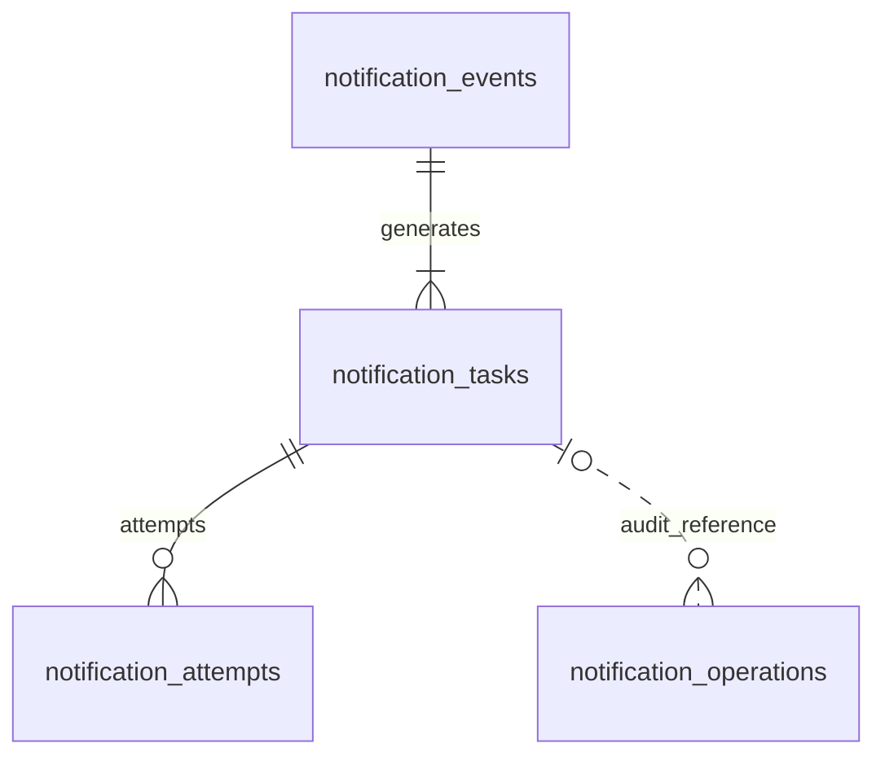

# 外部 API 通知服务 V1 数据库表与字段设计

| 项目 | 内容 |
| --- | --- |
| 文档版本 | V1.1，简化投递范围 |
| 日期 | 2026-10-13 |
| 数据库 | MySQL 8.4 / InnoDB |
| 配套方案 | [gRPC 通知服务技术方案](notification-service-v1-design.md) |
| 交付范围 | 表与字段定义、关系、约束、索引及建表 SQL；尚未执行迁移 |

## 1. 设计范围与通用约定

本设计覆盖通知服务自身的数据。业务系统仍通过 gRPC 提交事件，供应商侧仍通过 HTTP(S) 投递，不增加业务侧可靠发送或业务系统数据表。

路由、供应商协议和认证引用继续由版本化配置提供，不单独设计配置管理表。数据库只保存任务需要的协议快照，不保存私钥、Token、口令或实际签名。

本版本包含事件、投递任务、投递尝试和管理操作四张业务表；不设计供应商运行控制表，也不保存供应商暂停、并发配额或速率限制。

- 主键使用 BIGINT UNSIGNED，自增生成，关联字段使用相同类型；Go 映射 uint64。租约和幂等键使用应用生成的标准 UUID 字符串。
- 表使用 utf8mb4；来源、事件 ID、目标、版本及内部代码等机器标识使用 ascii_bin，区分大小写，接口禁止前后空格和非 ASCII 标识。业务数据及描述支持中文。
- 时间使用 DATETIME(6)，应用和数据库连接会话统一使用 UTC；连接设置 parseTime=true、loc=UTC，并将会话 time_zone 设为 +00:00。仅设置 Go 的 loc 不会自动设置 MySQL 会话时区。
- JSON 保存结构化内容，MEDIUMBLOB 保存实际请求字节；JSON 和 Body 不设通用默认值，由应用明确传入，空 Header 传空 JSON 对象。
- 状态使用字符串并通过 CHECK 限制合法值；状态转换、JSON 内容和跨表一致性仍由应用事务控制。
- “无默认值”表示写入时必须明确提供；“NULL”表示当前尚无该信息，不能用 0 或空字符串替代未知结果。
- ID 只用于定位记录，不代表访问权限；普通查询必须通过事件的 source_system 校验来源隔离。

DATETIME 微秒精度、JSON 格式校验和 CHECK 约束使用 MySQL 8.4 原生能力。参考：[时间类型](https://dev.mysql.com/doc/refman/8.4/en/date-and-time-types.html)、[JSON 类型](https://dev.mysql.com/doc/refman/8.4/en/json.html)、[CHECK 约束](https://dev.mysql.com/doc/refman/8.4/en/create-table-check-constraints.html)。

## 2. 表关系与职责

| 表名 | 简要作用 |
| --- | --- |
| notification_events | 记录“发生了什么”，并识别重复事件 |
| notification_tasks | 记录“需要通知谁、目前处理到哪一步” |
| notification_attempts | 记录“每一次实际尝试发生了什么” |
| notification_operations | 记录“谁做了什么管理操作”，避免重复重放 |



事件与任务、任务与尝试使用物理外键。管理审计与任务的关联是逻辑关系：审计要在任务清理后保留，目标基础配置来自文件。一个事件匹配多个供应商时产生多个任务，一项任务可以有多个执行轮次和多次尝试。

## 3. 详细字段设计

字段表中的字符类型省略字符集声明，完整声明见建表 SQL。日期默认值写为 CURRENT_TIMESTAMP(6) 时，依赖连接会话的 UTC 设置。

### 3.1 `notification_events`：事件表

保存本服务已经接收的标准事件，一行代表一个来源事件。用于接入去重、查询和追溯，不记录业务侧尚未送达的事件。

| 字段 | MySQL 类型 | 可空 | 默认值 | 作用 |
| --- | --- | --- | --- | --- |
| `id` | BIGINT UNSIGNED | 否 | 自增 | 本服务事件主键；任务通过它关联事件 |
| `source_system` | VARCHAR(64) | 否 | 无默认值 | 通过认证确定的来源系统，例如 subscription-system |
| `source_event_id` | VARCHAR(128) | 否 | 无默认值 | 调用方提供的事件 ID；与来源系统共同标识唯一事件 |
| `event_type` | VARCHAR(128) | 否 | 无默认值 | 事件类型，例如 subscription.paid，用于路由与协议识别 |
| `schema_version` | INT UNSIGNED | 否 | 1 | 事件业务契约版本，不是数据库迁移版本 |
| `occurred_at` | DATETIME(6) | 否 | 无默认值 | 事件发生时间；用于查询，不提供执行顺序保证 |
| `received_at` | DATETIME(6) | 否 | CURRENT_TIMESTAMP(6) | 事件被本服务接收的时间，也是创建记录时间 |
| `payload` | JSON | 否 | 无默认值 | 标准化完整事件，包含业务数据；用于查询和追溯 |
| `payload_hash` | BINARY(32) | 否 | 无默认值 | 标准化事件的 SHA-256 原始摘要，识别同 ID 不同内容 |
| `hash_version` | SMALLINT UNSIGNED | 否 | 1 | 内容标准化规则版本，支持规则升级后比较旧事件 |
| `routing_config_version` | VARCHAR(64) | 否 | 无默认值 | 接入时采用的路由配置版本，便于追溯目标来源 |

- `id` 是服务内部 ID，`source_event_id` 是来源事件 ID，两者不能混用。重复接入返回原 `id` 和任务列表。
- 内容摘要包含来源、来源事件 ID、事件类型、契约版本、发生时间和业务数据；不包含接收时间、认证信息或路由版本。
- 标准化遵循 Protobuf 字段语义，统一时间与默认值，忽略对象字段顺序，保留数组顺序和精确数字；不直接比较 Protobuf 字节或 MySQL JSON 的展示字符串。
- 查询到旧事件时，按其 `hash_version` 计算本次内容摘要。金额等精确数据不用 float64 中转。
- `payload` 保留完整事件时间精度，`occurred_at` 用微秒精度做检索；摘要以完整标准化事件为准。
- 事件内容接入后不可修改。路由变化不会给已有事件重新生成任务。

### 3.2 `notification_tasks`：投递任务表

保存每个事件向某个供应商目标投递的当前状态。一行代表一个独立投递任务，是 Worker 调度和管理查询的核心。

| 字段 | MySQL 类型 | 可空 | 默认值 | 作用 |
| --- | --- | --- | --- | --- |
| `id` | BIGINT UNSIGNED | 否 | 自增 | 任务主键，RPC 查询和尝试记录使用该 ID |
| `event_id` | BIGINT UNSIGNED | 否 | 无默认值 | 关联 notification_events.id，不是来源事件 ID |
| `destination_id` | VARCHAR(64) | 否 | 无默认值 | 供应商目标标识，与配置文件中的投递目标对应 |
| `adapter_key` | VARCHAR(128) | 否 | 无默认值 | 供应商适配器及协议版本，例如 crm.contact.v1 |
| `config_version` | VARCHAR(64) | 否 | 无默认值 | 任务生成时使用的目标配置版本 |
| `config_snapshot` | JSON | 否 | 无默认值 | 不可变协议配置及认证引用，不包含实际密钥 |
| `request_method` | VARCHAR(10) | 否 | 无默认值 | 外部请求方式，例如 POST |
| `request_url` | VARCHAR(2048) | 否 | 无默认值 | 准备后的目标地址，不含认证密钥、Token 或用户口令 |
| `request_headers` | JSON | 否 | 无默认值 | 稳定且非敏感的 Header 对象；没有 Header 时写空对象 |
| `request_content_type` | VARCHAR(128) | 否 | 无默认值 | Body 编码类型，例如 application/json |
| `request_body` | MEDIUMBLOB | 否 | 无默认值 | 固定业务请求字节，支持 JSON、form 等格式；允许空字节串 |
| `idempotency_mode` | VARCHAR(16) | 否 | 'none' | none / natural / provider_key，决定能否安全自动重试 |
| `idempotency_key` | CHAR(36) | 否 | 无默认值 | 应用生成的 UUID；同一任务重试和重放保持不变 |
| `idempotency_retention_seconds` | INT UNSIGNED | 是 | NULL | 供应商确认的幂等有效秒数，仅 provider_key 模式使用 |
| `first_attempt_at` | DATETIME(6) | 是 | NULL | 任务首次领取的时间，后续重放不清空 |
| `idempotency_valid_until` | DATETIME(6) | 是 | NULL | 供应商幂等窗口截止时间；首次领取时保守计算 |
| `state` | VARCHAR(24) | 否 | 'pending' | 任务状态，详见状态说明 |
| `attempt_count` | INT UNSIGNED | 否 | 0 | 任务所有轮次的累计领取次数，单调递增 |
| `run_no` | INT UNSIGNED | 否 | 1 | 执行轮次；每次批准重放增加 1 |
| `run_attempt_count` | INT UNSIGNED | 否 | 0 | 当前轮次已领取次数，批准重放后清零 |
| `max_attempts` | INT UNSIGNED | 否 | 12 | 当前轮次最多尝试次数，包含首次尝试 |
| `retry_policy` | JSON | 否 | 无默认值 | 任务生成时的退避基数、上限等重试策略，重放沿用 |
| `deadline_at` | DATETIME(6) | 否 | 无默认值 | 当前轮次执行期限，批准重放时重新设置 |
| `next_attempt_at` | DATETIME(6) | 是 | NULL | 待投递或等待重试时的可领取时间，其他状态为空 |
| `lease_token` | CHAR(36) | 是 | NULL | 当前执行权令牌，只有 running 状态存在 |
| `lease_until` | DATETIME(6) | 是 | NULL | 当前执行租约截止时间，用于崩溃恢复 |
| `last_http_status` | SMALLINT UNSIGNED | 是 | NULL | 最近 HTTP 响应状态；未取得响应时为空 |
| `last_provider_code` | VARCHAR(128) | 是 | NULL | 最近供应商业务状态码，按适配器协议提取 |
| `last_error_code` | VARCHAR(64) | 是 | NULL | 本服务最近错误分类，例如 CONNECT_TIMEOUT |
| `last_error_summary` | VARCHAR(512) | 是 | NULL | 最近错误的脱敏摘要，供列表快速展示 |
| `completed_at` | DATETIME(6) | 是 | NULL | 当前轮次进入成功、失败或待核实时的时间，重放清空 |
| `closed_at` | DATETIME(6) | 是 | NULL | 失败任务被管理员确认结束处理的时间；自动失败时为空 |
| `closed_by` | VARCHAR(128) | 是 | NULL | 确认结束失败任务处理的管理身份，与 closed_at 一起填写 |
| `created_at` | DATETIME(6) | 否 | CURRENT_TIMESTAMP(6) | 任务首次创建时间 |
| `updated_at` | DATETIME(6) | 否 | CURRENT_TIMESTAMP(6) ON UPDATE CURRENT_TIMESTAMP(6) | 任务最近状态变更时间 |

- `(event_id, destination_id)` 唯一，确保一个事件对同一目标只生成一项任务。多个目标独立维护结果。
- 同一个真实供应商可以有多个目标，例如不同账号或不同接口；`destination_id` 表示具体投递目标，不只是公司名称，发布后不复用其含义。
- URL、Header 和 Body 保存准备后的稳定业务请求。认证组件每次发送时按引用注入密钥、Token、时间戳和签名；这些敏感或动态字段不落入请求快照。
- `config_snapshot` 保存认证引用、超时和响应判定等不可变参数；已独立列化的调度、幂等字段以对应列为准。
- 申请租约即计为一次尝试，即使随后发送前崩溃，也保留记录；`attempt_count` 不等于供应商实际收到的请求数。
- 第一次领取时设置 `first_attempt_at`，provider_key 模式同时设置幂等窗口。重放只改变当前轮次预算，不延长原幂等窗口。
- `lease_token` 防止旧执行者覆盖新状态；它不能撤销已经到达供应商的请求。旧执行者迟到的结果保存到原尝试的迟到字段，不直接修改任务。
- `completed_at` 表示当前自动执行轮次结束，包含仍待人工处理的 needs_review；是否最终成功应看 `state`。
- `closed_at` 区分“自动失败后仍需补偿”和“管理员已决定结束处理”，仅 failed 状态允许填写。人工核实确已送达时直接改为 succeeded；不确定任务先完成核实才能关闭。
- `last_*` 是列表查询用的冗余摘要，原始历史以尝试表为准；更新时必须与任务状态在同一事务写入。
- 初始 deadline 和 next_attempt 时间由应用显式提供，不能把 next_attempt 默认 NULL 的列直接用于创建 pending 任务。

### 3.3 `notification_attempts`：投递尝试表

记录每一次领取和执行过程。一项任务可以有多次尝试，重放后的尝试继续追加，既不覆盖历史，也不重新从 1 编号。

| 字段 | MySQL 类型 | 可空 | 默认值 | 作用 |
| --- | --- | --- | --- | --- |
| `id` | BIGINT UNSIGNED | 否 | 自增 | 尝试记录主键 |
| `task_id` | BIGINT UNSIGNED | 否 | 无默认值 | 关联 notification_tasks.id |
| `attempt_no` | INT UNSIGNED | 否 | 无默认值 | 任务生命周期中的尝试序号，与累计计数一致 |
| `run_no` | INT UNSIGNED | 否 | 无默认值 | 所属执行轮次，便于区分首次执行和人工重放 |
| `lease_token` | CHAR(36) | 否 | 无默认值 | 该次领取生成的租约令牌，与任务执行权对应 |
| `worker_id` | VARCHAR(128) | 否 | 无默认值 | 执行者实例标识，用于定位进程与日志 |
| `started_at` | DATETIME(6) | 否 | CURRENT_TIMESTAMP(6) | 领取任务并创建尝试记录的时间 |
| `finished_at` | DATETIME(6) | 是 | NULL | 结果落库或租约恢复完成的时间 |
| `duration_ms` | INT UNSIGNED | 是 | NULL | HTTP 执行耗时；未测得有效耗时时为空 |
| `outcome` | VARCHAR(24) | 否 | 'started' | started / success / retryable / permanent_failure / unknown |
| `http_status` | SMALLINT UNSIGNED | 是 | NULL | 本次取得的 HTTP 响应状态，未取得响应时为空 |
| `provider_code` | VARCHAR(128) | 是 | NULL | 本次响应中的供应商业务码 |
| `error_code` | VARCHAR(64) | 是 | NULL | 本次错误的内部分类 |
| `error_summary` | VARCHAR(512) | 是 | NULL | 本次错误的脱敏说明 |
| `response_summary` | JSON | 是 | NULL | 白名单响应字段或脱敏摘要，不存完整原始响应 |
| `response_truncated` | BOOLEAN | 否 | 0 | 响应超过读取上限或摘要被截断时标记为 1 |
| `late_result_at` | DATETIME(6) | 是 | NULL | 租约失效后才取得可信执行结果的时间 |
| `late_result_summary` | JSON | 是 | NULL | 迟到结果的脱敏信息，不覆盖原 unknown 判定 |

- 创建尝试记录与领取任务在同一事务完成；保存结果与任务状态变更也在同一事务完成。
- `outcome=retryable` 表示本次故障可重试，任务仍可能因为预算耗尽变为 failed；`unknown` 表示未确认外部执行结果，有效幂等任务仍可能安全进入下一次尝试。
- 租约恢复把尚未完成的 started 标记为 unknown，保留原序号和租约。迟到响应写入 `late_result_*`，供人工核实，不覆盖恢复时的原判断。
- duration_ms 由 Go 的单调时钟测量发送过程，崩溃后无法准确测量时保留 NULL，不以租约时长伪造 HTTP 耗时。
- 网络层可能发生透明重试，一项尝试也不一定严格对应一次底层网络发送。

### 3.4 `notification_operations`：管理操作表

保存成功提交的人工重放和结果核实操作，并为重复管理 RPC 提供幂等依据。被拒绝的管理请求记录到应用审计日志。

| 字段 | MySQL 类型 | 可空 | 默认值 | 作用 |
| --- | --- | --- | --- | --- |
| `id` | BIGINT UNSIGNED | 否 | 自增 | 管理操作记录主键 |
| `operator_id` | VARCHAR(128) | 否 | 无默认值 | 从管理认证中取得的操作者身份，不由请求自由填写 |
| `operation_id` | VARCHAR(128) | 否 | 无默认值 | 管理员客户端提供的操作 ID，用于重复请求去重 |
| `operation_type` | VARCHAR(32) | 否 | 无默认值 | replay_task / resolve_task |
| `task_id` | BIGINT UNSIGNED | 否 | 无默认值 | 被操作任务的历史 ID，任务清理后仍保留 |
| `destination_id` | VARCHAR(64) | 否 | 无默认值 | 被操作目标，从任务中取得该值 |
| `request_hash` | BINARY(32) | 否 | 无默认值 | 管理操作标准化参数摘要；同操作 ID 不同参数视为冲突 |
| `reason` | VARCHAR(512) | 否 | 无默认值 | 操作原因，例如凭据已修正或已核实供应商未执行 |
| `request_summary` | JSON | 否 | 无默认值 | 脱敏参数及核实依据；不包含认证凭据 |
| `before_snapshot` | JSON | 否 | 无默认值 | 操作前的任务状态和执行轮次 |
| `after_snapshot` | JSON | 否 | 无默认值 | 操作后的任务状态和执行轮次 |
| `result_summary` | JSON | 否 | 无默认值 | 可重复返回的操作结果，如新轮次和任务状态 |
| `created_at` | DATETIME(6) | 否 | CURRENT_TIMESTAMP(6) | 操作成功提交记录的时间 |

- 管理操作与目标状态修改在同一个事务中提交；不存在先写“成功审计”再单独修改任务的流程。
- 重复 `(operator_id, operation_id)` 且参数相同，返回保存的 result_summary；参数不同则拒绝，不再次修改任务。
- operation_id 需要跨操作类型保持唯一，同一操作者不能复用它执行不同动作。
- 不设置 task_id 的物理外键，保留任务被清理之后的审计证据；写入前在事务中验证任务存在并锁定。
- 已提交操作记录不可修改。task_id 表示操作时的历史关联，不保证任务永久存在。

## 4. 状态、索引与关键写入规则

### 4.1 任务状态

| 状态 | 作用 | 时间和租约要求 |
| --- | --- | --- |
| pending | 新任务或已批准重放，等待领取 | next_attempt_at 非空，没有租约 |
| running | 已领取，执行或等待结果落库 | 有租约，next_attempt_at 为空 |
| retry_wait | 暂时失败，等待下一次尝试 | next_attempt_at 非空，没有租约 |
| succeeded | 协议确认投递成功，或人工核实成功 | completed_at 非空，没有租约 |
| failed | 明确失败，或自动尝试预算耗尽 | completed_at 非空，没有租约 |
| needs_review | 外部结果不确定，需要人工核实 | completed_at 非空，没有租约 |

需要重放的失败或待核实任务，不会自动再次进入 pending。预算耗尽的失败任务也不能被当作新事件重复提交后重新生成。

### 4.2 索引与约束作用

| 表 | 索引或约束 | 作用 |
| --- | --- | --- |
| events | 来源 + 来源事件 ID 唯一 | 并发接入同一事件时去重 |
| events | 来源/事件类型 + 接收时间 + ID | 查询某来源或类型的事件，支持稳定分页 |
| tasks | 事件 + 目标唯一 | 防止对同一目标重复创建任务；同时支持按事件查任务 |
| tasks | 幂等键唯一 | 防止不同任务意外复用同一幂等键 |
| tasks | 状态 + 下次执行时间 + ID | 领取全局到期任务 |
| tasks | 状态 + 租约截止时间 + ID | 找出执行租约过期的任务 |
| tasks | 目标/状态 + 创建时间 + ID | 管理筛选与分页 |
| attempts | 任务 + 尝试序号唯一 | 一个序号只对应一条记录，同时支持任务历史查询 |
| attempts | 开始时间 + ID | 按时间清理或检索历史 |
| operations | 操作者 + 操作 ID 唯一 | 避免同一管理请求重复产生副作用 |

MySQL 不使用 PostgreSQL 的部分索引；这里采用普通联合索引。实际领取涉及状态集合和时间排序，需用 EXPLAIN 与真实数据验证执行计划，不假设所有排序都能完全由索引消除。

### 4.3 服务内事务流程

1. **接入**：在同一事务插入事件和所有目标任务。新任务写 pending、run_no=1、计数为 0、next_attempt_at 为当前数据库时间、deadline_at 为配置规定的期限。唯一冲突后读取原事件，按其 hash_version 校验内容，再返回原任务；不覆盖原 payload。
2. **领取**：获得执行容量后，在短事务中用行锁与 SKIP LOCKED 选择到期任务，增加累计和本轮计数，生成新租约，写 running 并清空 next_attempt_at，同时插入 started 尝试；第一次领取设置首次时间和适用的幂等窗口。
3. **执行**：提交领取事务后发送 HTTP，不持有数据库事务或行锁。上下文独立于已结束的接入 RPC。
4. **结果**：锁定并确认 task_id + running + lease_token，且 lease_until 尚未过期后，在同一事务结束尝试并更新任务。重试写 next_attempt_at；成功、失败、待核实写 completed_at；离开 running 时清空租约。
5. **恢复**：锁定并再次确认租约已过期，将未结束尝试置为 unknown。能安全重试且仍有预算则安排重试，否则进入待核实或失败；若迟到执行者随后返回，只写 late_result 字段，不覆盖新任务状态。
6. **维护**：已过期限或耗尽预算的待投递、等待重试任务明确变为 failed，避免它们被领取条件永久排除后仍显示为等待中。
7. **重放**：验证状态、外部核实依据和原幂等窗口，增加 run_no，本轮计数清零，重设期限，清空 completed_at、closed_at、closed_by 和上一轮 last_* 摘要，写 pending 与下次时间；保留总计数、首次时间、请求和幂等键，同事务写管理记录。第一版拒绝已过期供应商幂等键的原任务重放，不自动续期或换键；先核实并关闭旧任务，再按业务补偿方案处理。
8. **人工核实或关闭**：needs_review 根据外部证据转换为 succeeded 或 failed；管理员确认失败任务不再需要自动或人工补偿时，填写 closed_at 和 closed_by，并通过 resolve_task 审计保存依据。成功不会伪装成失败关闭；只写关闭标记也不能跳过核实。

所有任务更新遵循固定锁顺序：先任务，再尝试或审计。死锁或锁等待错误时仅重试安全的数据库事务，不把数据库写回重试变成重复发送 HTTP。数据库去重键、管理操作键和外部幂等键是不同层次的机制。

## 5. MySQL 8.4 建表 SQL

以下用于后续迁移文件，当前仅保存在文档内，不创建数据库或写入实际数据。按事件、任务、尝试、管理的顺序建表，物理外键禁止自动级联删除。

应用负责配置 JSON 的结构、UUID 格式、地址与长度校验；CHECK 只约束单行不变量，不承担状态转换或跨表验证。每个 CHECK 使用独立名称，且不引用自增主键或物理外键列。

```sql
SET SESSION time_zone = '+00:00';

CREATE TABLE `notification_events` (
  `id` BIGINT UNSIGNED NOT NULL AUTO_INCREMENT COMMENT '本服务事件主键；任务通过它关联事件',
  `source_system` VARCHAR(64) CHARACTER SET ascii COLLATE ascii_bin NOT NULL COMMENT '通过认证确定的来源系统，例如 subscription-system',
  `source_event_id` VARCHAR(128) CHARACTER SET ascii COLLATE ascii_bin NOT NULL COMMENT '调用方提供的事件 ID；与来源系统共同标识唯一事件',
  `event_type` VARCHAR(128) CHARACTER SET ascii COLLATE ascii_bin NOT NULL COMMENT '事件类型，例如 subscription.paid，用于路由与协议识别',
  `schema_version` INT UNSIGNED NOT NULL DEFAULT 1 COMMENT '事件业务契约版本，不是数据库迁移版本',
  `occurred_at` DATETIME(6) NOT NULL COMMENT '事件发生时间；用于查询，不提供执行顺序保证',
  `received_at` DATETIME(6) NOT NULL DEFAULT CURRENT_TIMESTAMP(6) COMMENT '事件被本服务接收的时间，也是创建记录时间',
  `payload` JSON NOT NULL COMMENT '标准化完整事件，包含业务数据；用于查询和追溯',
  `payload_hash` BINARY(32) NOT NULL COMMENT '标准化事件的 SHA-256 原始摘要，识别同 ID 不同内容',
  `hash_version` SMALLINT UNSIGNED NOT NULL DEFAULT 1 COMMENT '内容标准化规则版本，支持规则升级后比较旧事件',
  `routing_config_version` VARCHAR(64) CHARACTER SET ascii COLLATE ascii_bin NOT NULL COMMENT '接入时采用的路由配置版本，便于追溯目标来源',
  PRIMARY KEY (`id`),
  UNIQUE KEY `uk_events_source_event` (`source_system`, `source_event_id`),
  KEY `idx_events_source_received` (`source_system`, `received_at`, `id`),
  KEY `idx_events_type_received` (`event_type`, `received_at`, `id`),
  CONSTRAINT `chk_events_versions` CHECK (`schema_version` > 0 AND `hash_version` > 0)
) ENGINE=InnoDB DEFAULT CHARSET=utf8mb4 COLLATE=utf8mb4_0900_as_cs COMMENT='事件表';

CREATE TABLE `notification_tasks` (
  `id` BIGINT UNSIGNED NOT NULL AUTO_INCREMENT COMMENT '任务主键，RPC 查询和尝试记录使用该 ID',
  `event_id` BIGINT UNSIGNED NOT NULL COMMENT '关联 notification_events.id，不是来源事件 ID',
  `destination_id` VARCHAR(64) CHARACTER SET ascii COLLATE ascii_bin NOT NULL COMMENT '供应商目标标识，与配置文件中的投递目标对应',
  `adapter_key` VARCHAR(128) CHARACTER SET ascii COLLATE ascii_bin NOT NULL COMMENT '供应商适配器及协议版本，例如 crm.contact.v1',
  `config_version` VARCHAR(64) CHARACTER SET ascii COLLATE ascii_bin NOT NULL COMMENT '任务生成时使用的目标配置版本',
  `config_snapshot` JSON NOT NULL COMMENT '不可变协议配置及认证引用，不包含实际密钥',
  `request_method` VARCHAR(10) CHARACTER SET ascii COLLATE ascii_bin NOT NULL COMMENT '外部请求方式，例如 POST',
  `request_url` VARCHAR(2048) NOT NULL COMMENT '准备后的目标地址，不含认证密钥、Token 或用户口令',
  `request_headers` JSON NOT NULL COMMENT '稳定且非敏感的 Header 对象；没有 Header 时写空对象',
  `request_content_type` VARCHAR(128) CHARACTER SET ascii COLLATE ascii_bin NOT NULL COMMENT 'Body 编码类型，例如 application/json',
  `request_body` MEDIUMBLOB NOT NULL COMMENT '固定业务请求字节，支持 JSON、form 等格式；允许空字节串',
  `idempotency_mode` VARCHAR(16) CHARACTER SET ascii COLLATE ascii_bin NOT NULL DEFAULT 'none' COMMENT 'none / natural / provider_key，决定能否安全自动重试',
  `idempotency_key` CHAR(36) CHARACTER SET ascii COLLATE ascii_bin NOT NULL COMMENT '应用生成的 UUID；同一任务重试和重放保持不变',
  `idempotency_retention_seconds` INT UNSIGNED NULL DEFAULT NULL COMMENT '供应商确认的幂等有效秒数，仅 provider_key 模式使用',
  `first_attempt_at` DATETIME(6) NULL DEFAULT NULL COMMENT '任务首次领取的时间，后续重放不清空',
  `idempotency_valid_until` DATETIME(6) NULL DEFAULT NULL COMMENT '供应商幂等窗口截止时间；首次领取时保守计算',
  `state` VARCHAR(24) CHARACTER SET ascii COLLATE ascii_bin NOT NULL DEFAULT 'pending' COMMENT '任务状态，详见状态说明',
  `attempt_count` INT UNSIGNED NOT NULL DEFAULT 0 COMMENT '任务所有轮次的累计领取次数，单调递增',
  `run_no` INT UNSIGNED NOT NULL DEFAULT 1 COMMENT '执行轮次；每次批准重放增加 1',
  `run_attempt_count` INT UNSIGNED NOT NULL DEFAULT 0 COMMENT '当前轮次已领取次数，批准重放后清零',
  `max_attempts` INT UNSIGNED NOT NULL DEFAULT 12 COMMENT '当前轮次最多尝试次数，包含首次尝试',
  `retry_policy` JSON NOT NULL COMMENT '任务生成时的退避基数、上限等重试策略，重放沿用',
  `deadline_at` DATETIME(6) NOT NULL COMMENT '当前轮次执行期限，批准重放时重新设置',
  `next_attempt_at` DATETIME(6) NULL DEFAULT NULL COMMENT '待投递或等待重试时的可领取时间，其他状态为空',
  `lease_token` CHAR(36) CHARACTER SET ascii COLLATE ascii_bin NULL DEFAULT NULL COMMENT '当前执行权令牌，只有 running 状态存在',
  `lease_until` DATETIME(6) NULL DEFAULT NULL COMMENT '当前执行租约截止时间，用于崩溃恢复',
  `last_http_status` SMALLINT UNSIGNED NULL DEFAULT NULL COMMENT '最近 HTTP 响应状态；未取得响应时为空',
  `last_provider_code` VARCHAR(128) NULL DEFAULT NULL COMMENT '最近供应商业务状态码，按适配器协议提取',
  `last_error_code` VARCHAR(64) CHARACTER SET ascii COLLATE ascii_bin NULL DEFAULT NULL COMMENT '本服务最近错误分类，例如 CONNECT_TIMEOUT',
  `last_error_summary` VARCHAR(512) NULL DEFAULT NULL COMMENT '最近错误的脱敏摘要，供列表快速展示',
  `completed_at` DATETIME(6) NULL DEFAULT NULL COMMENT '当前轮次进入成功、失败或待核实时的时间，重放清空',
  `closed_at` DATETIME(6) NULL DEFAULT NULL COMMENT '失败任务被管理员确认结束处理的时间；自动失败时为空',
  `closed_by` VARCHAR(128) CHARACTER SET ascii COLLATE ascii_bin NULL DEFAULT NULL COMMENT '确认结束失败任务处理的管理身份，与 closed_at 一起填写',
  `created_at` DATETIME(6) NOT NULL DEFAULT CURRENT_TIMESTAMP(6) COMMENT '任务首次创建时间',
  `updated_at` DATETIME(6) NOT NULL DEFAULT CURRENT_TIMESTAMP(6) ON UPDATE CURRENT_TIMESTAMP(6) COMMENT '任务最近状态变更时间',
  PRIMARY KEY (`id`),
  UNIQUE KEY `uk_tasks_event_destination` (`event_id`, `destination_id`),
  UNIQUE KEY `uk_tasks_idempotency` (`idempotency_key`),
  KEY `idx_tasks_due` (`state`, `next_attempt_at`, `id`),
  KEY `idx_tasks_lease` (`state`, `lease_until`, `id`),
  KEY `idx_tasks_destination_list` (`destination_id`, `state`, `created_at`, `id`),
  KEY `idx_tasks_state_list` (`state`, `created_at`, `id`),
  CONSTRAINT `fk_tasks_event` FOREIGN KEY (`event_id`) REFERENCES `notification_events` (`id`) ON DELETE RESTRICT ON UPDATE RESTRICT,
  CONSTRAINT `chk_tasks_state` CHECK (`state` IN ('pending','running','retry_wait','succeeded','failed','needs_review')),
  CONSTRAINT `chk_tasks_idempotency_mode` CHECK (`idempotency_mode` IN ('none','natural','provider_key')),
  CONSTRAINT `chk_tasks_counters` CHECK (`run_no` > 0 AND `max_attempts` > 0 AND `run_attempt_count` <= `max_attempts` AND `attempt_count` >= `run_attempt_count`),
  CONSTRAINT `chk_tasks_lease` CHECK ((`state` = 'running' AND `lease_token` IS NOT NULL AND `lease_until` IS NOT NULL) OR (`state` <> 'running' AND `lease_token` IS NULL AND `lease_until` IS NULL)),
  CONSTRAINT `chk_tasks_next_attempt` CHECK ((`state` IN ('pending','retry_wait') AND `next_attempt_at` IS NOT NULL) OR (`state` NOT IN ('pending','retry_wait') AND `next_attempt_at` IS NULL)),
  CONSTRAINT `chk_tasks_completion` CHECK ((`state` IN ('succeeded','failed','needs_review') AND `completed_at` IS NOT NULL) OR (`state` IN ('pending','running','retry_wait') AND `completed_at` IS NULL)),
  CONSTRAINT `chk_tasks_closed` CHECK ((`closed_at` IS NULL AND `closed_by` IS NULL) OR (`state` = 'failed' AND `closed_at` IS NOT NULL AND `closed_by` IS NOT NULL)),
  CONSTRAINT `chk_tasks_window` CHECK ((`idempotency_mode` = 'provider_key' AND `idempotency_retention_seconds` IS NOT NULL AND `idempotency_retention_seconds` > 0 AND ((`first_attempt_at` IS NULL AND `idempotency_valid_until` IS NULL) OR (`first_attempt_at` IS NOT NULL AND `idempotency_valid_until` IS NOT NULL AND `idempotency_valid_until` > `first_attempt_at`))) OR (`idempotency_mode` IN ('none','natural') AND `idempotency_retention_seconds` IS NULL AND `idempotency_valid_until` IS NULL)),
  CONSTRAINT `chk_tasks_http_status` CHECK (`last_http_status` IS NULL OR `last_http_status` BETWEEN 100 AND 599)
) ENGINE=InnoDB DEFAULT CHARSET=utf8mb4 COLLATE=utf8mb4_0900_as_cs COMMENT='投递任务表';

CREATE TABLE `notification_attempts` (
  `id` BIGINT UNSIGNED NOT NULL AUTO_INCREMENT COMMENT '尝试记录主键',
  `task_id` BIGINT UNSIGNED NOT NULL COMMENT '关联 notification_tasks.id',
  `attempt_no` INT UNSIGNED NOT NULL COMMENT '任务生命周期中的尝试序号，与累计计数一致',
  `run_no` INT UNSIGNED NOT NULL COMMENT '所属执行轮次，便于区分首次执行和人工重放',
  `lease_token` CHAR(36) CHARACTER SET ascii COLLATE ascii_bin NOT NULL COMMENT '该次领取生成的租约令牌，与任务执行权对应',
  `worker_id` VARCHAR(128) CHARACTER SET ascii COLLATE ascii_bin NOT NULL COMMENT '执行者实例标识，用于定位进程与日志',
  `started_at` DATETIME(6) NOT NULL DEFAULT CURRENT_TIMESTAMP(6) COMMENT '领取任务并创建尝试记录的时间',
  `finished_at` DATETIME(6) NULL DEFAULT NULL COMMENT '结果落库或租约恢复完成的时间',
  `duration_ms` INT UNSIGNED NULL DEFAULT NULL COMMENT 'HTTP 执行耗时；未测得有效耗时时为空',
  `outcome` VARCHAR(24) CHARACTER SET ascii COLLATE ascii_bin NOT NULL DEFAULT 'started' COMMENT 'started / success / retryable / permanent_failure / unknown',
  `http_status` SMALLINT UNSIGNED NULL DEFAULT NULL COMMENT '本次取得的 HTTP 响应状态，未取得响应时为空',
  `provider_code` VARCHAR(128) NULL DEFAULT NULL COMMENT '本次响应中的供应商业务码',
  `error_code` VARCHAR(64) CHARACTER SET ascii COLLATE ascii_bin NULL DEFAULT NULL COMMENT '本次错误的内部分类',
  `error_summary` VARCHAR(512) NULL DEFAULT NULL COMMENT '本次错误的脱敏说明',
  `response_summary` JSON NULL DEFAULT NULL COMMENT '白名单响应字段或脱敏摘要，不存完整原始响应',
  `response_truncated` BOOLEAN NOT NULL DEFAULT 0 COMMENT '响应超过读取上限或摘要被截断时标记为 1',
  `late_result_at` DATETIME(6) NULL DEFAULT NULL COMMENT '租约失效后才取得可信执行结果的时间',
  `late_result_summary` JSON NULL DEFAULT NULL COMMENT '迟到结果的脱敏信息，不覆盖原 unknown 判定',
  PRIMARY KEY (`id`),
  UNIQUE KEY `uk_attempts_task_no` (`task_id`, `attempt_no`),
  KEY `idx_attempts_started` (`started_at`, `id`),
  CONSTRAINT `fk_attempts_task` FOREIGN KEY (`task_id`) REFERENCES `notification_tasks` (`id`) ON DELETE RESTRICT ON UPDATE RESTRICT,
  CONSTRAINT `chk_attempts_numbers` CHECK (`attempt_no` > 0 AND `run_no` > 0),
  CONSTRAINT `chk_attempts_outcome` CHECK (`outcome` IN ('started','success','retryable','permanent_failure','unknown')),
  CONSTRAINT `chk_attempts_finished` CHECK ((`outcome` = 'started' AND `finished_at` IS NULL) OR (`outcome` <> 'started' AND `finished_at` IS NOT NULL)),
  CONSTRAINT `chk_attempts_http_status` CHECK (`http_status` IS NULL OR `http_status` BETWEEN 100 AND 599),
  CONSTRAINT `chk_attempts_truncated` CHECK (`response_truncated` IN (0,1)),
  CONSTRAINT `chk_attempts_late_result` CHECK ((`late_result_at` IS NULL AND `late_result_summary` IS NULL) OR (`late_result_at` IS NOT NULL AND `late_result_summary` IS NOT NULL))
) ENGINE=InnoDB DEFAULT CHARSET=utf8mb4 COLLATE=utf8mb4_0900_as_cs COMMENT='投递尝试表';

CREATE TABLE `notification_operations` (
  `id` BIGINT UNSIGNED NOT NULL AUTO_INCREMENT COMMENT '管理操作记录主键',
  `operator_id` VARCHAR(128) CHARACTER SET ascii COLLATE ascii_bin NOT NULL COMMENT '从管理认证中取得的操作者身份，不由请求自由填写',
  `operation_id` VARCHAR(128) CHARACTER SET ascii COLLATE ascii_bin NOT NULL COMMENT '管理员客户端提供的操作 ID，用于重复请求去重',
  `operation_type` VARCHAR(32) CHARACTER SET ascii COLLATE ascii_bin NOT NULL COMMENT 'replay_task / resolve_task',
  `task_id` BIGINT UNSIGNED NOT NULL COMMENT '被操作任务的历史 ID，任务清理后仍保留',
  `destination_id` VARCHAR(64) CHARACTER SET ascii COLLATE ascii_bin NOT NULL COMMENT '被操作目标，从任务中取得该值',
  `request_hash` BINARY(32) NOT NULL COMMENT '管理操作标准化参数摘要；同操作 ID 不同参数视为冲突',
  `reason` VARCHAR(512) NOT NULL COMMENT '操作原因，例如凭据已修正或已核实供应商未执行',
  `request_summary` JSON NOT NULL COMMENT '脱敏参数及核实依据；不包含认证凭据',
  `before_snapshot` JSON NOT NULL COMMENT '操作前的任务状态和执行轮次',
  `after_snapshot` JSON NOT NULL COMMENT '操作后的任务状态和执行轮次',
  `result_summary` JSON NOT NULL COMMENT '可重复返回的操作结果，如新轮次和任务状态',
  `created_at` DATETIME(6) NOT NULL DEFAULT CURRENT_TIMESTAMP(6) COMMENT '操作成功提交记录的时间',
  PRIMARY KEY (`id`),
  UNIQUE KEY `uk_operations_operator_operation` (`operator_id`, `operation_id`),
  KEY `idx_operations_task_time` (`task_id`, `created_at`, `id`),
  KEY `idx_operations_destination_time` (`destination_id`, `created_at`, `id`),
  CONSTRAINT `chk_operations_type` CHECK (`operation_type` IN ('replay_task','resolve_task'))
) ENGINE=InnoDB DEFAULT CHARSET=utf8mb4 COLLATE=utf8mb4_0900_as_cs COMMENT='管理操作表';

```

## 6. 数据保留与实施注意事项

- 初始建议：成功任务自 completed_at 起保留 90 天；失败任务先由管理员确认关闭，再自 closed_at 起保留 90 天。未关闭失败和待核实记录不自动删除，避免删掉仍需补偿的任务。管理审计建议至少保留 180 天，具体期限由项目确认。
- needs_review 必须先核实并转换状态，不能直接清理。失败任务关闭通过 resolve_task 管理操作保存依据，关闭不代表供应商已处理成功。
- 清理以事件为单位：全部目标任务均满足清理条件后，分批按尝试 → 任务 → 事件顺序删除。管理记录不随任务级联删除。
- 事件删除后，同来源事件 ID 的接入去重失效。若业务需要超过保留期的去重，增加轻量去重凭证表，不宣称目前设计永久去重。
- 索引中的调度列使用独立字段，不从 JSON 动态提取；业务 payload 不为未知查询预建大量索引。
- 使用严格 SQL 模式，保持 InnoDB 持久化与备份配置符合运行要求；多实例读取用于查询时需考虑复制延迟，任务领取和状态修改只使用主库。
- JSON、错误摘要、请求快照和管理证据均遵守脱敏要求，认证信息只保存 Secret 引用。
- 上线前在真实 MySQL 8.4 执行迁移并验证唯一约束、CHECK、外键、租约竞争与查询计划；本文的静态检查不等于数据库执行验证。
