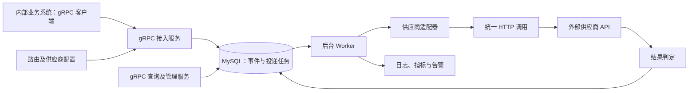

# 外部 API 通知服务 V1 技术方案

| 项目 | 方案 |
| --- | --- |
| 版本 | V1.3，gRPC + MySQL 简化投递版 |
| 日期 | 2026-10-13 |
| 核心选型 | Go + gRPC-Go + Protobuf + MySQL + 后台 Worker |
| 文档范围 | 技术选型、系统框架、业务功能思路与处理流程 |

## 1. 目标与边界

建设统一的内部通知服务。业务系统提交标准事件，服务根据路由规则生成通知任务，将事件转换为供应商需要的 HTTP(S) 请求，并负责异步投递、结果判定、重试和运维处理。

内部业务系统通过 gRPC 调用本服务，接入、查询和管理均使用 RPC 接口；本服务调用外部供应商时仍使用 HTTP(S)。

典型场景包括注册成功后通知广告渠道、付款成功后更新 CRM 状态、购买商品后通知库存系统。

本版本只开发通知服务，不涉及业务系统自身逻辑，也不处理业务事务与通知服务调用之间的可靠性。本服务的可靠性责任从事件和任务成功提交到自身数据库开始。

业务系统不用等待外部 API 返回结果，但通知服务仍需检查 HTTP 状态和供应商业务响应，判断是否送达成功。

本次假设下游不会持续超时，也不会对调用进行限流，因此不开发供应商隔离、每供应商并发或速率配额、暂停和恢复控制。仍保留单次请求超时、偶发失败重试、幂等判定和任务恢复。

## 2. 技术选型

| 层次 | 选型 | 使用思路 |
| --- | --- | --- |
| 开发语言 | Go | 使用固定大小的 Worker 池执行任务，context 控制单次请求超时和服务退出 |
| RPC 框架 | gRPC-Go（google.golang.org/grpc） | 提供事件接入、查询和管理接口，通过拦截器统一认证、参数校验、异常恢复和调用日志 |
| 接口契约 | Protobuf + protoc Go 插件 | 使用 .proto 定义请求、响应与服务，生成服务端和客户端代码，管理协议版本 |
| 外部 HTTP 调用 | Go 标准库 net/http | 复用 HTTP 客户端和连接，统一超时、响应读取与认证处理 |
| 数据库 | MySQL 8.4，InnoDB | 保存事件、任务、投递历史和管理记录，利用事务、唯一约束和行锁管理任务 |
| 数据访问 | database/sql + go-sql-driver/mysql | 使用标准连接池和显式事务，实现任务领取和状态更新 |
| 后台调度 | 服务内 Worker | 从数据库轮询到期任务，通过并发池执行通知 |
| 配置与凭据 | 版本化配置文件 + 环境变量或 Secret | 管理路由、协议参数和认证引用，数据库不保存明文凭据 |
| 日志与监控 | slog + Prometheus 指标 | 记录投递过程，监控积压、失败和等待时间 |
| 本地运行 | Docker Compose | 启动应用、MySQL 和模拟供应商，验证完整流程 |
| RPC 调试 | grpcurl / grpcui | 本地通过反射或导入 .proto 调用接口，检查请求、响应和 metadata |

第一版使用 MySQL 同时承担持久化任务队列和业务记录存储，不引入 Redis 或消息队列。数据库访问使用显式 SQL 和事务，便于控制领取任务时的锁范围。

通过 protoc 及 Go 插件按 Protobuf 契约生成客户端和服务端接口，由 gRPC-Go 承载 RPC 调用；MySQL 驱动与 Go 的 database/sql 配合使用。参考：[gRPC Go 官方文档](https://grpc.io/docs/languages/go/basics/)、[Go MySQL 驱动文档](https://github.com/go-sql-driver/mysql)。

## 3. 系统框架

系统按职责分为以下模块：

| 模块 | 主要职责 |
| --- | --- |
| RPC 接入层 | 注册 Protobuf 服务，通过拦截器认证与校验，返回接入结果 |
| 业务编排层 | 事件去重、路由匹配、生成任务、管理重放 |
| 供应商适配层 | 转换请求格式、处理协议差异、定义成功和错误规则 |
| 投递执行层 | 调度任务、发送请求、控制单次超时和失败重试 |
| 持久化层 | 保存事件、任务、尝试历史和操作审计 |
| 运维层 | 状态查询、人工处理和监控告警 |

RPC Server 和 Worker 使用同一个工程，可以分别运行。本地可以合并启动；生产建议将二者分开部署。第一版 Worker 单活运行，使用固定大小的任务执行池，部署切换时通过单活控制避免两个 Worker 同时调度。

### 3.1 RPC 契约与运行方式

- 业务接入和查询归入通知服务，重放和结果核实归入管理服务，分别校验权限。
- 第一版使用一元 RPC：一次请求返回一次结果；事件提交成功后异步投递，不使用长连接流等待供应商结果。
- 通过 Protobuf 明确定义事件和业务数据类型，按版本演进契约，新增字段保持兼容，不复用已删除字段编号。
- 身份信息通过 gRPC metadata 传递；来源系统身份由服务端认证结果确定，不能只相信请求中的来源字段。
- RPC 设置接入超时、消息大小限制和服务端处理上限；生产使用 TLS，并确保代理或负载均衡支持 gRPC 的 HTTP/2 通信。
- 已持久化任务使用 Worker 独立的执行上下文，调用方 RPC 结束或取消不影响其后续后台投递。

### 3.2 RPC 结果语义

接入事务成功提交后返回 gRPC OK，并在响应中提供事件 ID、任务 ID 和已接收状态。相同内容的重复事件也返回 OK，附带重复标识和原任务信息。

参数或事件契约错误使用 INVALID_ARGUMENT；同一事件 ID 对应不同内容使用 ALREADY_EXISTS；无匹配路由或不允许的重放状态使用 FAILED_PRECONDITION；认证失败使用 UNAUTHENTICATED，权限不足使用 PERMISSION_DENIED；临时数据库故障使用 UNAVAILABLE。错误信息提供可定位的业务原因。[gRPC 状态码说明](https://grpc.io/docs/guides/status-codes/)

查询 RPC 成功表示查询完成，外部投递是否成功由响应中的任务状态表达。RPC 超时不代表数据库一定未提交；事件和任务的实际状态以持久化记录为准。本方案仍不展开业务侧可靠调用流程。

## 4. 业务功能实现思路

### 4.1 标准事件接入与去重

业务系统通过生成的 gRPC 客户端提交事件 ID、来源系统、事件类型、协议版本、发生时间和类型明确的业务数据。它只需要提供业务事实，无需了解各供应商 URL、Header 或 Body 格式。

服务通过接入凭据识别来源，校验事件契约，并使用“来源系统 + 事件 ID”去重，数据库唯一约束作为最终保证：

- 同一事件重复提交，返回原事件及任务，不生成重复通知。
- 同一事件 ID 对应不同内容，拒绝请求，避免覆盖原事件。
- 来源不合法、事件不支持、缺少必要字段或没有匹配路由时，明确返回错误。

内部事件与所有目标任务在同一个 MySQL 事务中保存。提交成功后通过 RPC 响应确认已接收，外部投递将在后台执行。内容去重按业务字段语义比较，不直接依赖 Protobuf 序列化字节是否相同。

### 4.2 路由与供应商适配

通过“来源 + 事件类型 + 协议版本”匹配路由，广告场景可以增加渠道匹配。一个事件可以对应多个供应商，每个目标形成独立任务。

| 示例事件 | 路由及处理方式 |
| --- | --- |
| 注册成功 | 根据广告渠道选择供应商，转换为渠道要求的注册通知 |
| 订阅付款成功 | 路由到 CRM，转换客户标识与目标状态 |
| 购买商品成功 | 路由到库存供应商，转换商品、订单及变更信息 |

简单差异通过配置管理，包括地址、请求方式、单次超时和凭据引用；复杂字段映射、签名和响应判定通过 Go 适配器实现。

适配器在接入阶段校验必要数据并准备业务请求。任一目标无法生成合法请求时，本次接入整体失败，避免生成部分任务。接入阶段不调用外部供应商。

任务保存接入时的配置版本和请求内容，后续重试使用相同业务数据。认证凭据在发送时读取，时间戳和签名按协议重新生成，支持凭据轮换。

### 4.3 数据保存与异步投递

MySQL 保存以下几类记录，不在本方案展开字段和建表语句：

| 记录 | 用途 |
| --- | --- |
| 事件 | 保存来源、标准事件内容和接入去重信息 |
| 投递任务 | 保存目标、请求快照、状态、执行期限和重试计划 |
| 投递尝试 | 保存每次执行的时间、耗时、响应分类与错误原因 |
| 管理操作记录 | 保存人工重放、结果核实和操作审计 |

Worker 在有空闲执行位置时，从数据库领取到期任务。领取阶段使用短事务和行锁，更新任务执行状态并记录租约，然后提交事务，再发起外部 HTTP 请求。

MySQL 支持 FOR UPDATE 配合 SKIP LOCKED 处理队列表的竞争。本方案仅在任务领取场景使用，HTTP 调用期间不持有数据库事务或行锁。[MySQL 官方锁定读取说明](https://dev.mysql.com/doc/refman/8.4/en/innodb-locking-reads.html)

投递结束后保存结果并更新任务。更新须确认当前执行租约仍有效，防止旧执行者覆盖新状态。进程退出后，过期租约由后台恢复，根据任务是否可安全重试决定重新调度或转人工核实。

任务状态包括待投递、投递中、等待重试、成功、失败和待核实。任务和投递历史存储在数据库，服务重启后可以继续处理。

### 4.4 结果判定、重试与幂等

每个供应商明确成功规则，不能仅以 HTTP 200 判断成功，也不能假设所有 2xx 都代表供应商业务已经完成。

| 情况 | 处理思路 |
| --- | --- |
| 满足供应商约定的成功条件 | 标记成功，停止投递 |
| 偶发网络错误或服务端临时故障 | 确认可以安全重试后，生成下次执行计划 |
| 参数、认证或配置错误 | 标记失败并告警，修正后人工处理 |
| 请求可能已执行，但未获得可信响应 | 有幂等保障时重试，否则进入待核实 |

重试采用指数退避和随机抖动。每项任务设置最大尝试次数和执行期限，超过限制后停止自动投递、保留失败原因，等待人工补偿。重试等待不占用执行位置。单次外部请求设置连接和总执行超时、限制响应大小，并校验 TLS 证书。

内部去重只能防止重复创建任务，无法消除外部重复执行。外部优先使用供应商确认支持的幂等键；同一任务重试和重放保持业务请求和幂等键不变，并检查供应商幂等有效期。

对库存扣减等有副作用且不支持幂等的接口，超时或进程崩溃后不能确认执行结果时，不自动重复发送。需要人工核实供应商是否已执行。明确确认请求未发送或未执行的故障，可以按协议重试。

### 4.5 查询、人工处理与监控

通过 gRPC 提供事件、任务和投递历史查询。业务系统只能查询自身来源的数据；管理员通过管理 RPC 查看失败任务、核实不确定结果和发起重放。

重放沿用原任务和请求快照，保留历史记录，开启新的执行轮次。只允许失败或待核实任务重放，已经成功的任务不重复发送。对结果不确定的任务，先核实外部执行情况；供应商幂等键已过期时，第一版拒绝原任务重放，不自动续期或更换键，核实并关闭旧任务后按业务补偿方案处理；管理操作记录操作者和原因，并防止重复操作重复启动任务。

监控重点包括各供应商成功率、响应耗时、任务积压、最老任务等待时间、重试耗尽和待核实数量。出现失败任务、异常积压、数据库不可用或 Worker 停止调度时，由现有告警系统通知运维。

日志和响应摘要脱敏，不记录明文凭据、签名或非必要个人信息。第一版提供管理 RPC，不开发管理前端。Prometheus 指标通过独立内网 HTTP 端口暴露，仅用于指标采集。

### 4.6 RPC 调试与验证

本地开发环境开启 gRPC Reflection，通过 grpcurl 查看服务并发送请求，或用 grpcui 选择方法、填写参数和查看响应。没有开启反射时，工具导入 .proto 文件进行调试；反射功能由环境配置控制。[gRPC 反射说明](https://grpc.io/docs/guides/reflection/)

验证覆盖接入、重复事件、来源权限、任务查询、管理重放和 RPC 超时。调试 RPC 与供应商模拟接口配合使用，检查已接收事件是否被 Worker 正常处理。

## 5. 完整处理流程

### 5.1 正常投递

1. 业务系统通过 gRPC 客户端提交标准事件。
2. 服务认证、校验并检查重复事件。
3. 匹配供应商路由，准备各目标请求。
4. 在 MySQL 中事务保存事件和独立投递任务。
5. 返回 gRPC OK 和已接收结果，不等待供应商响应。
6. Worker 从数据库领取到期任务，记录执行状态和租约。
7. 注入认证信息，发送外部 HTTP 请求。
8. 根据供应商协议判断成功，保存尝试记录及任务结果。

### 5.2 失败与恢复

1. 投递失败后，判断是否能够安全重试。
2. 能安全重试且预算未耗尽：保存下一次执行时间，等待重新调度。
3. 永久失败、超过次数或期限：停止自动投递并告警。
4. 结果不确定且没有幂等保障：转为待核实。
5. 服务重启或执行租约过期：恢复任务，仍按上述安全规则处理。
6. 管理员修复问题、核实外部结果后，标记处理结果或启动重放。

一个事件对应多个供应商时，各任务独立完成。失败目标的重试或重放不会导致已成功目标再次发送。

## 6. 第一版落地安排

按“通用主链路 → 故障恢复 → 运维能力 → 真实供应商接入”的顺序开发：

1. 定义 Protobuf 契约，完成 gRPC Server、拦截器、MySQL 持久化、路由和模拟适配器，实现正常投递。
2. 补齐任务租约、单次超时、重试、幂等判定和重启恢复。
3. 提供查询和管理 RPC、人工核实、重放、日志与指标，并通过 grpcurl / grpcui 验证。
4. 根据真实供应商协议实现适配器，验证偶发请求超时、响应丢失、进程退出、重复事件和部分目标失败等场景。

开发前需确认真实供应商协议、认证方式和幂等能力，以及事件字段、峰值流量和允许延迟。第一版不保证同一客户或订单事件的执行顺序；若存在顺序要求，需要在对应场景上线前补充按业务标识串行处理。

本版本不涉及业务侧可靠发送、消息队列或跨供应商事务。保留可查询、可核实和可补偿的失败记录。
